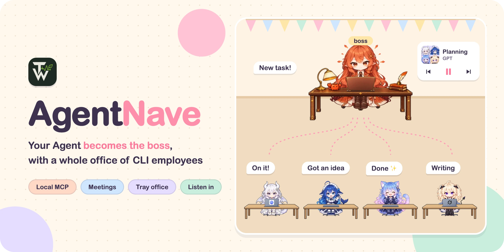
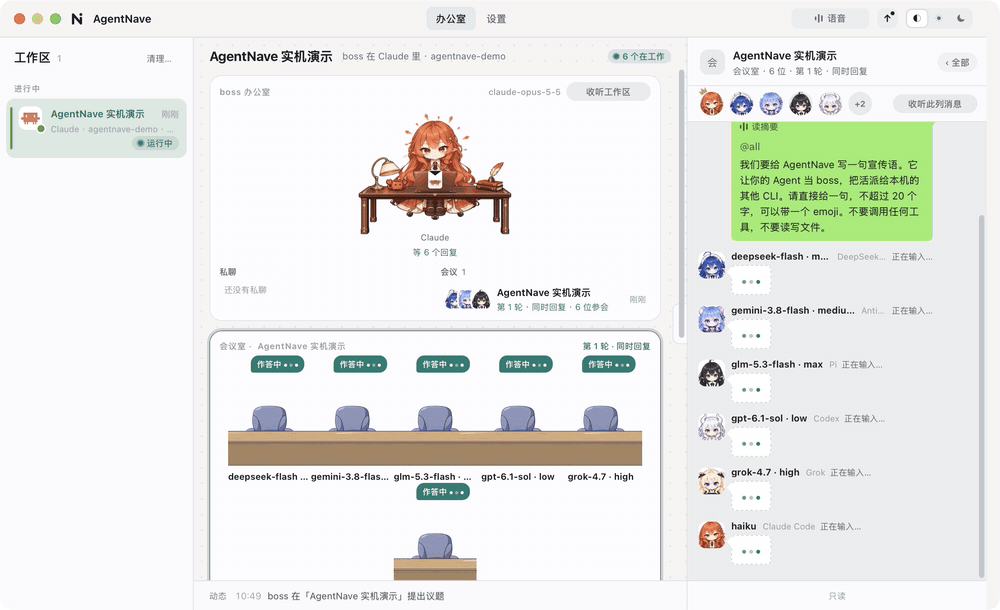
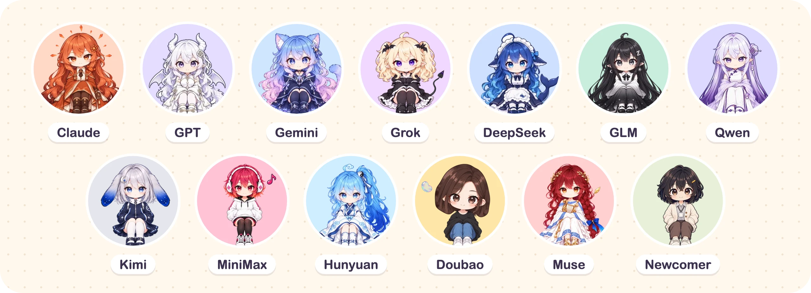

<p align="center">
  
</p>

<p align="center">
  <a href="README.md">简体中文</a> · <b>English</b>
</p>

<p align="center">
  <a href="https://github.com/TimWongUp/agentnave/releases/latest"></a>
  <a href="LICENSE"></a>
  
  
  
</p>

**AgentNave is a local MCP server.** The Agent you already use (Claude Code, Codex, …) becomes the boss and hands work to the other CLIs installed on your machine. The tray App is a small office: you can see who is working, who is in a meeting and what everyone said, and you can listen in too.

## 🎬 Live demo

<p align="center"></p>

## ✨ Highlights

### 🧑‍💼 One boss, a whole office of CLIs

13 hosts can be the boss and 9 CLIs can be employees, all driven through the same tools. Each CLI keeps its own login and configuration, and you can pick up any past conversation later.

### 👯 Private tasks and meetings

Send one employee a task and the result goes back only to the boss, or bring 2–7 employees into a meeting: by default two parallel rounds, where everyone proposes on their own, then revises after reading all the answers, and the boss sums up. Add a serial round to finish in turns. With review on, the boss decides for each answer whether it is published or kept private; other seats never see a private answer.

### 🏢 An office you can see

Desks, the meeting room and every conversation at a glance, and the menu bar shows who is working at any time. Characters follow the model family, or upload your own set. When a host exits, the tasks it started are cancelled and its meeting seats are marked absent for that round; if the service itself is killed before it can clean up, they show as interrupted the next time you open the app. Orphaned tasks never stay running forever.

### 🎧 An office you can hear

Click Listen and the App reads a meeting, a private chat or a whole workspace aloud, for 1 hour by default, then stops on its own. Each meeting or private chat is an album, and clicking the speaker jumps to the message being read. Voice uses your own ElevenLabs or MiniMax key, and message text is sent to the cloud engine you choose.

### 🙋 The boss answers prompts

On macOS and Linux, Claude runs interactively by default, which saves subscription quota. Permission prompts, questions and plan confirmations go to the boss, so you don't have to sit and watch. So do the actions Devin's automatic approval cannot judge. CLI permission tiers default to full access; the App can switch them to automatic approval.

### 🧭 Seats and review

Pick models for the easy and hard tiers of general exploration and execution in the App, turn on specialists such as interface work, writing or web research as needed, and the boss dispatches by task type and difficulty. An optional image generation seat selects a CLI and its conversation model, which calls its own image service. You can also add a [review before merging](skills/agentnave-review/SKILL.md): how much review a change gets depends on its risk, reviewers read but never edit, and their conclusions are kept as a record.

### 🤝 Continue in another chat

Tell the boss to hand this chat over, then say take over in a new chat. If quota ran out before a note could be written, the new boss can take over that host's session.

### 🧹 The App handles the chores

Connecting a host installs the Skills, and an employee has to be confirmed before it can be dispatched. CLIs with a new version update in one click, and missing ones come with the official install command. The App and the local service update inside the App, old workspaces clear in one click, and history cleans up after the number of days you set.

## 👀 Who can be the boss, who can be an employee

| Role                                                | Supported                                                                                                                                     |
| --------------------------------------------------- | --------------------------------------------------------------------------------------------------------------------------------------------- |
| **Boss** (connects to AgentNave and hands out work) | Claude desktop app, Claude Code, Codex CLI, CodeBuddy Code, WorkBuddy desktop app, Grok CLI, Antigravity, Pi, DeepSeek Harness, ZCode, Devin CLI / desktop app, Hermes, Grok Bot (Linux only) |
| **Employee** (the CLI that gets the work)           | Claude Code, Codex CLI, CodeBuddy Code, Grok CLI, Antigravity CLI, Pi Coding Agent, DeepSeek Harness, ZCode, Devin CLI                                   |

A host never sends a single task to its own CLI, though its CLI can take a seat in a meeting.

When both a desktop bundled and a standalone Codex CLI are detected, select the employee's CLI source on the Employees page. Automatic uses the bundled CLI first. If a selected installation is unavailable, dispatch fails instead of switching to the other one.

Grok Bot connects only on Linux, not through the macOS or Windows App, and its model and sessions can't be read back. See the [headless Linux host guide](docs/linux-headless.md) (in Chinese).

## 🎀 Meet the team

<p align="center">
  
</p>

Characters follow the **model family**, not the CLI: run GPT through Codex CLI and the little dragon girl shows up. A model
without a character of its own is covered by the Newcomer. On the App's Appearance page you can switch between CSS characters and video packs, or replace a model family's CSS character with your own set; see the [custom CSS characters guide](docs/custom-characters.md) (in Chinese).

## 🚀 Quick start

You need [`uv`](https://docs.astral.sh/uv/), Git and at least one CLI that is already signed in. AgentNave does not
install or sign in to CLIs for you.

### Option 1: the tray App (macOS and Windows, recommended)

1. Download the installer from [Releases](https://github.com/TimWongUp/agentnave/releases/latest): on macOS, `AgentNave_<version>_universal.dmg`, dragged into Applications; on Windows, `AgentNave_<version>_x64-setup.exe`.
2. Open the App, connect a host on the boss page in Settings, and confirm other CLIs under **Employees** as needed. The App installs the local service and the companion Skills.
3. Back in your host, try:

   ```text
   Use agentnave to have two employees each answer: what does this repository do?
   ```

The App's interface is available in English and Chinese; choose it under Settings → General.

### Option 2: manual install (Linux, or without the App)

The paired release is **`v1.8.0`**; install both the runtime and the Skill from that tag:

```bash
uv tool install --python 3.12 "git+https://github.com/TimWongUp/agentnave.git@v1.8.0"
```

Then follow the [installation guide](docs/installation.md) to register the MCP server, install the
[agentnave-manager](skills/agentnave-manager/SKILL.md) and [agentnave-handover](skills/agentnave-handover/SKILL.md) Skills and verify both. The guide is written for Agents, so you
can hand it straight to yours and let it check and install. **Headless Linux (no App)**: bots such as Grok Bot that run on Linux
and connect only as an MCP connector follow the [Linux after-install guide](docs/linux-after-install.md) (in Chinese) to walk
the user through setup; config file details are in the [headless Linux host guide](docs/linux-headless.md) (in Chinese).

Task and meeting history lives in `~/.agentnave/` (or the directory set by `AGENTNAVE_DATA_DIR`). Each CLI's login,
configuration and native sessions stay with that CLI.

## 🧭 Who decides what

AgentNave only sends the work out, looks after the processes and brings the results back intact. How to split a task,
whom to ask and whether to double-check stay with the boss, who already has the full context.

| AgentNave                                | The boss                               |
| ---------------------------------------- | -------------------------------------- |
| Starts and stops each CLI                | Plans and splits the work              |
| Sees tasks through, leaves no strays     | Picks who does it and with which model |
| Brings the results back intact           | Decides how many at once and any review |
| Keeps task and meeting records           | Decides whether to retry a failure     |
| Runs the rounds of a meeting             | Who answers, in what order, how well   |

By default AgentNave runs a dispatched CLI with full access. When Claude runs interactively, and whenever Devin runs, the boss answers the prompts
that still need one. The App can switch a CLI to automatic approval. AgentNave has no
command line for people: you just talk to the boss.

<details>
<summary>🔒 What happens to tasks, and security</summary>

When the host closes, AgentNave stops any employee still running. The saved records stay, and saved meetings and past conversations can continue later.

**AgentNave is not a sandbox.** It looks after processes, and what an employee can do depends on each CLI's own permission settings. When you need strict isolation, use isolation at the operating-system level.

</details>

<details>
<summary>🛠️ Development and verification</summary>

These checks are for a development checkout, not the `uv tool` installation above. See
[CONTRIBUTING.md](CONTRIBUTING.md) for the complete workflow.

```bash
uv sync --locked --all-groups
uv run ruff format --check .
uv run ruff check .
uv run pyright
uv run pytest
```

</details>

## 🤝 Contributing

Contributions are welcome through GitHub Issues and pull requests; see [CONTRIBUTING.md](CONTRIBUTING.md) for the
workflow and validation requirements. Do not report security vulnerabilities in a public Issue: follow
[SECURITY.md](SECURITY.md) to use the repository's private reporting channel.

## 🙏 Acknowledgements

Viewing sessions from the tray, and reading Claude and Codex session records to tell which app a boss
chats in, follow approaches from [magpie](https://github.com/yetone/magpie). CLI icons come from
[LobeHub Icons](https://github.com/lobehub/lobe-icons) (MIT).

## 📄 License

AgentNave is licensed under the [MIT License](LICENSE).
