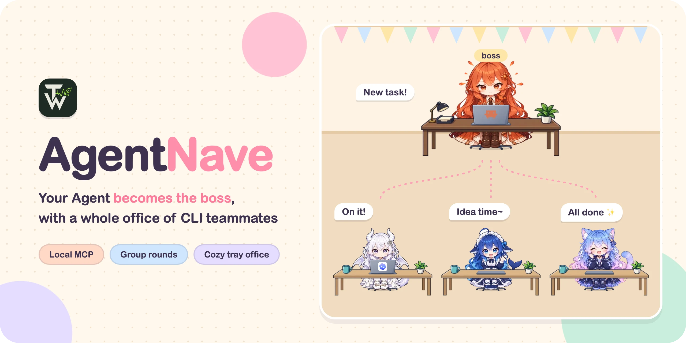
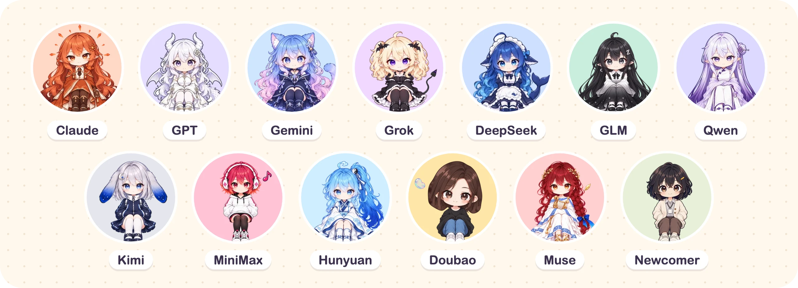

<p align="center">
  
</p>

<p align="center">
  <a href="README.md">简体中文</a> · <b>English</b>
</p>

<p align="center">
  <a href="https://github.com/TimWongUp/agentnave/releases/latest"></a>
  <a href="LICENSE"></a>
  
  
  
</p>

**AgentNave is a local MCP server.** The Agent you already use (Claude Code, Codex, …) becomes the boss and
hands work to the other CLIs installed on your machine: one at a time, or several together, answering side by
side in parallel or taking turns in serial rounds. A tray "office" App shows who is working at their desk, who
has gone to the meeting room, and what everyone said.

## 🎬 Live demo

<p align="center"></p>

## ✨ What it does

- 🧑‍💼 **Send one teammate a task**: `start_agent` hands a task to one CLI; the result goes back only to the boss
- 👯 **Call a meeting**: `run_round` brings 2–7 teammates into the meeting room. By default it runs two parallel rounds: everyone proposes on their own, then revises after reading all the answers, and the boss sums up. Ask for a final serial round when you want them to close it out in turn, each speaker seeing the earlier answers
- 🔍 **Review before sharing**: with review on, the boss decides for each answer whether it is published or kept private; other seats never see a private answer
- 🏢 **A cozy tray office**: desks, the meeting room and every conversation at a glance, with one-click cleanup of old workspaces
- 🧠 **Native sessions stay native**: each CLI keeps its own login, configuration and native session; its `session_id` is kept so you can continue later
- 🤝 **Hand over to another chat**: `handover` passes a whole workspace to another boss chat

## 👀 Who can be the boss, who can be a teammate

| Role                                                | Supported                                                                                                                                     |
| --------------------------------------------------- | --------------------------------------------------------------------------------------------------------------------------------------------- |
| **Boss** (connects to AgentNave and hands out work) | Claude desktop app, Claude Code, Codex CLI, CodeBuddy Code, WorkBuddy desktop app, Grok CLI, Antigravity, Pi, DeepSeek Harness, ZCode, Hermes |
| **Teammate** (the CLI that gets the work)           | Claude Code, Codex CLI, CodeBuddy Code, Grok CLI, Antigravity CLI, Pi Coding Agent, DeepSeek Harness, ZCode                                   |

The boss side is wider: any of these hosts can be the boss, desktop apps included, while teammates are only the CLIs listed. A host never sends a single `start_agent` task to its own CLI, though its CLI can still take a seat in a meeting.

## 🎀 Meet the team

<p align="center">
  
</p>

Characters follow the **model family**, not the CLI: run GPT through Codex CLI and the little dragon girl shows up. A model
without a character of its own is covered by the Newcomer. To use your own characters, upload a set on the App's 头像 (Avatars) page.

## 🚀 Quick start

You need [`uv`](https://docs.astral.sh/uv/), Git and at least one CLI that is already signed in. AgentNave does not
install or sign in to CLIs for you.

### Option 1: the tray App (macOS, recommended)

1. Download `AgentNave_<version>_universal.dmg` from [Releases](https://github.com/TimWongUp/agentnave/releases/latest)
   and drag it into Applications.
2. Open the App and follow the four 开始使用 (Get started) steps: **install the local service → connect a host → set up
   teammates → send a task from the host**. Connecting a host also installs the companion `agentnave-manager` Skill.
3. Back in your host, try:

   ```text
   Use agentnave to have two teammates each answer: what does this repository do?
   ```

The App's interface is currently in Chinese.

### Option 2: manual install (Windows / Linux, or without the App)

The paired release is **`v0.58.0`**; install both the runtime and the Skill from that tag:

```bash
uv tool install --python 3.12 "git+https://github.com/TimWongUp/agentnave.git@v0.58.0"
```

Then follow the [installation guide](docs/installation.md) to register the MCP server, install the
[agentnave-manager Skill](skills/agentnave-manager/SKILL.md) and verify both. The guide is written for Agents, so you
can hand it straight to yours and let it check and install. The optional
[agentnave-review Skill](skills/agentnave-review/SKILL.md) adds a risk-graded review gate for PRs and merges, staffed by
read-only reviewer CLIs that AgentNave dispatches.

Task and meeting history lives in `~/.agentnave/` (or the directory set by `AGENTNAVE_DATA_DIR`). Each CLI's login,
configuration and native sessions stay with that CLI.

## 🧰 The MCP tools

| Tool                | Purpose                                                                                   |
| ------------------- | ----------------------------------------------------------------------------------------- |
| `start_agent`       | Start one CLI task; returns an `invocation_id` immediately and saves the task             |
| `run_round`         | Open a meeting of 2–7 seats, run a parallel or serial round, or post a host remark        |
| `wait`              | Wait up to 240 seconds by default; returns early when ready; use `0` for a progress check |
| `cancel`            | Stop a task or a round and return its final result                                        |
| `decide_answers`    | With review on, publish each answer or keep it private                                    |
| `list`              | List current handles and saved conversations, and start the read-only dashboard           |
| `read_conversation` | Read one conversation back as the App shows it                                            |
| `list_members`      | Read the teammate defaults set in the App, and one CLI's options                          |
| `handover`          | Hand this chat's whole workspace to another boss chat, or list and take over waiting ones |

Omitted model, effort and options use the teammate defaults set in the App; a run still without an effort gets the
CLI's own configured one. Both are listed in `defaults_applied`; explicit parameters win. The [agentnave-manager Skill](skills/agentnave-manager/SKILL.md) covers CLI choice and options, the
[conversation guide](docs/studio.md) (in Chinese) covers review, host remarks, isolated seats and the dashboard, and
[architecture](docs/context/architecture.md) lists the stable contracts and output limits.

## 🧭 Who decides what

AgentNave only sends the work out, looks after the processes and brings the results back intact. How to split a task,
whom to ask and whether to double-check stay with the boss, who already has the full context.

| AgentNave                                  | The boss (calling Agent)                   |
| ------------------------------------------ | ------------------------------------------ |
| Provider command adapters                  | Planning and task decomposition            |
| In-memory invocation lifecycle             | Provider and model selection               |
| POSIX process groups / Windows Job Objects | Parallelism, review and synthesis          |
| Normalized terminal results                | Retries, permissions and worktrees         |
| Saved parallel and serial meeting rounds   | Who answers, in what order, and acceptance |

A dispatched CLI has no one to click "approve", so by default AgentNave runs it with its own automatic approval
reviewer, or without approvals where it has none. The App can switch a CLI to full access. AgentNave has no
human-facing CLI: `agentnave-mcp` is only the STDIO entry point an MCP host starts.

<details>
<summary>🔒 Lifecycle and security</summary>

Invocation handles live only in the current MCP server process and expire seven days after completion. When the server
stops, AgentNave makes a best-effort attempt to end processes still in the provider process tree. A restart cannot
recover old handles, but saved meetings continue and a retained provider `session_id` can be passed to a new
`start_agent` call.

On macOS/Linux each provider runs under a dedicated POSIX process-group supervisor; on Windows under a kill-on-close
Job Object. Windows providers are created suspended, assigned to the Job Object, and only then resumed, so descendants
cannot start outside the owned process tree.

**AgentNave is not a sandbox.** On POSIX, a same-user provider with command permission can deliberately daemonize,
kill its supervisor or otherwise escape process-group cleanup. Windows Job Objects provide tree ownership but do not
isolate the provider from the user account or the rest of the machine. Provider-native permissions remain the
security boundary; use OS-level isolation when adversarial containment is required.

</details>

<details>
<summary>🛠️ Development and verification</summary>

These checks are for a development checkout, not the `uv tool` installation above. See
[CONTRIBUTING.md](CONTRIBUTING.md) for the complete workflow.

```bash
uv sync --locked --all-groups
uv run ruff format --check .
uv run ruff check .
uv run pyright
uv run pytest
```

</details>

## 🤝 Contributing

Contributions are welcome through GitHub Issues and pull requests; see [CONTRIBUTING.md](CONTRIBUTING.md) for the
workflow and validation requirements. Do not report security vulnerabilities in a public Issue: follow
[SECURITY.md](SECURITY.md) to use the repository's private reporting channel.

## 📄 License

AgentNave is licensed under the [MIT License](LICENSE).
