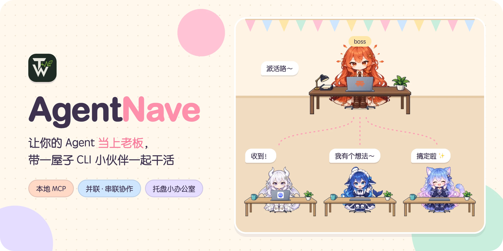
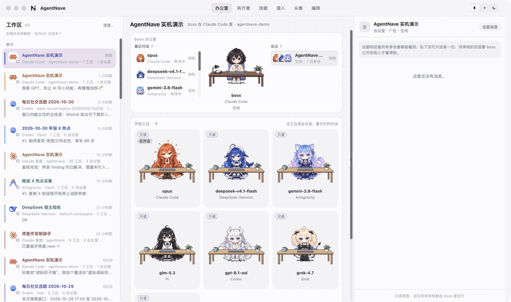
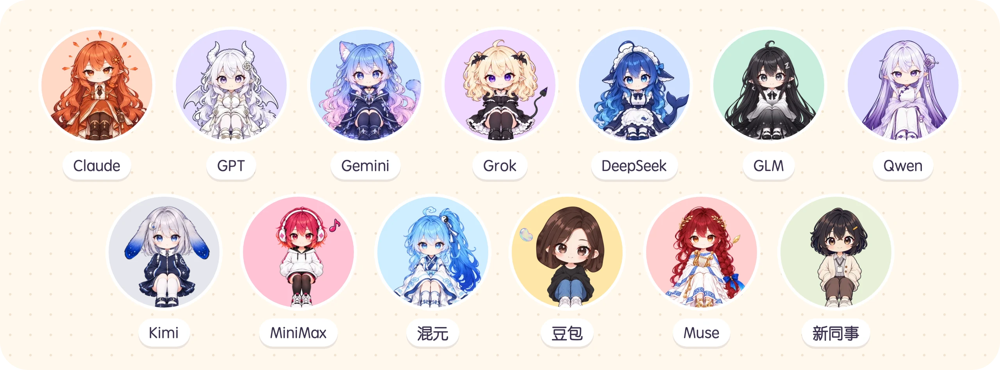

<p align="center">
  
</p>

<p align="center">
  <b>简体中文</b> · <a href="README.en.md">English</a>
</p>

<p align="center">
  <a href="https://github.com/TimWongUp/agentnave/releases/latest"></a>
  <a href="LICENSE"></a>
  
  
  
</p>

**AgentNave 是一个本地 MCP 服务。** 你正在用的 Agent（Claude Code、Codex……）当老板，把活派给本机装好的其他
CLI：可以单独派一位，也可以拉几位一起，并联各答各的，或者串联轮流发言。另有一个托盘「小办公室」App：
谁在工位上干活、谁去了会议室、大家说了什么，都能看到。

## 🎬 实机演示

<p align="center"></p>

## ✨ 能做什么

- 🧑‍💼 **派一位组员干活**：`start_agent` 把任务交给一个 CLI，结果只回给老板
- 👯 **拉几位组员开个会**：`run_round` 请 2–7 位组员进会议室。默认开两轮并联：第一轮各自给方案，第二轮看过大家的回答再补充，最后由 boss 总结。想让大家最后接力收个尾，就加一轮串联，后发言的人能看到前面的回答
- 🔍 **先审再公开**：开了审核，每条回答由老板决定公开还是留作私聊，不公开的回答其他席位看不到
- 🏢 **托盘小办公室**：工位、会议室、对话记录一目了然，旧工作区可以一键清理
- 🧠 **原生会话照旧**：每个 CLI 用自己的登录、配置和原生会话，保留 `session_id`，之后能接着聊
- 🤝 **换个聊天接着干**：`handover` 把整个工作区交给另一个老板聊天接手

## 👀 谁当老板，谁当组员

| 角色                                 | 支持                                                                                                                                |
| ------------------------------------ | ----------------------------------------------------------------------------------------------------------------------------------- |
| **老板**（接入 AgentNave、负责派活） | Claude 桌面端、Claude Code、Codex CLI、CodeBuddy Code、WorkBuddy 桌面端、Grok CLI、Antigravity、Pi、DeepSeek Harness、ZCode、Hermes |
| **组员**（被派活的 CLI）             | Claude Code、Codex CLI、CodeBuddy Code、Grok CLI、Antigravity CLI、Pi Coding Agent、DeepSeek Harness、ZCode                         |

老板的范围更大：上面这些宿主都能当老板，桌面端也可以；组员目前只有表里这几个 CLI。宿主不会用 `start_agent` 把单个任务派给自己的 CLI，但会议里可以有它的席位。

## 🎀 组员图鉴

<p align="center">
  
</p>

小人按**模型家族**分配，不看用的是哪个 CLI：用 Codex CLI 跑 GPT，出场的就是 GPT 那位小龙娘。没有专属形象的模型由「新同事」代班。
想换成自己的小人，在 App 设置的「外观」页上传一套就行。

## 🚀 快速开始

先准备好 [`uv`](https://docs.astral.sh/uv/)、Git，以及至少一个已经登录的 CLI。AgentNave 不帮你安装或登录 CLI。

### 方式一：托盘 App（macOS，推荐）

1. 到 [Releases](https://github.com/TimWongUp/agentnave/releases/latest) 下载 `AgentNave_<版本>_universal.dmg`，拖进「应用程序」。
2. 打开 App，按「开始使用」走完四步：**安装本机服务 → 接入一个宿主 → 设置组员 → 在宿主里派一次任务**。
   接入宿主时，App 会顺便装好配套的 `agentnave-manager` Skill。
3. 回到宿主里说一句试试：

   ```text
   用 agentnave 让两位组员各自回答一遍：这个仓库是做什么的？
   ```

### 方式二：手动安装（Windows / Linux，或不装 App）

当前配套版本是 **`v0.53.1`**，运行时和 Skill 都要从这个 tag 安装：

```bash
uv tool install --python 3.12 "git+https://github.com/TimWongUp/agentnave.git@v0.53.1"
```

然后按[安装指南](docs/installation.md)注册 MCP、安装 [agentnave-manager Skill](skills/agentnave-manager/SKILL.md)，再做验证。
安装指南本来就是写给 Agent 看的，可以直接交给你的 Agent，让它照着检查和安装。
可选的 [agentnave-review Skill](skills/agentnave-review/SKILL.md) 是一道按风险分级的 PR／合并评审门，评审工位也由 AgentNave 派出去的只读 CLI 担任。

任务和会议的历史保存在 `~/.agentnave/`（也可以用 `AGENTNAVE_DATA_DIR` 指定别的目录）。各 CLI 的登录、配置和原生会话仍归 CLI 自己管。

## 🧰 MCP 工具一览

| 工具                | 用途                                                                 |
| ------------------- | -------------------------------------------------------------------- |
| `start_agent`       | 派一个 CLI 任务，立即返回 `invocation_id`，任务会自动保存            |
| `run_round`         | 开一场 2–7 席的会议、跑一轮并联或串联，或者以主持人身份发言          |
| `wait`              | 最多等五分钟，任一任务或轮次有结果就提前返回                         |
| `cancel`            | 停止任务或轮次，返回它的最终结果                                     |
| `decide_answers`    | 开了审核时，逐条决定回答公开还是留作私聊                             |
| `list`              | 列出当前句柄和已保存的对话，并启动只读看板                           |
| `read_conversation` | 按 App 里看到的样子读回一段对话                                      |
| `list_members`      | 读取 App 里设定的组员默认值，以及某个 CLI 支持的参数                 |
| `handover`          | 把本聊天的整个工作区交给另一个老板聊天，或列出、认领等待接手的工作区 |

没传的 model、effort 和 options 会套用 App 里的组员默认值，回执的 `defaults_applied` 会写明补了哪些；显式参数优先。
CLI 选择与参数见 [agentnave-manager Skill](skills/agentnave-manager/SKILL.md)，审核、主持人发言、隔离席位和看板见[会话指南](docs/studio.md)，
稳定接口与输出上限见[架构说明](docs/context/architecture.md)。

## 🧭 分工：AgentNave 管什么

AgentNave 只负责把活派出去、管好进程、把结果原样带回来。怎么拆任务、找谁、要不要复核，都由老板来定，因为完整的上下文在老板手里。

| AgentNave                         | 老板（调用方 Agent）           |
| --------------------------------- | ------------------------------ |
| 各 CLI 的命令适配                 | 规划和拆分任务                 |
| 内存中的调用生命周期              | 选 CLI、选模型                 |
| POSIX 进程组 / Windows Job Object | 并行度、复核与综合             |
| 统一格式的终态结果                | 重试、权限和 worktree          |
| 保存的并联／串联会议轮次          | 谁来答、按什么顺序、答得行不行 |

派出去的 CLI 没法找人点「批准」，所以 AgentNave 默认让它用自带的自动审批；CLI 没有自动审批时就直接放开。在 App 里也可以把某个 CLI 改成完全放开。
AgentNave 没有给人用的命令行，`agentnave-mcp` 只是 MCP 宿主启动它用的 STDIO 入口。

<details>
<summary>🔒 生命周期与安全</summary>

调用句柄只存在于当前 MCP 服务进程里，完成七天后失效。服务停止时，AgentNave 会尽力结束仍留在 Provider 进程树里的进程。
重启后找不回旧句柄，但保存的会议可以继续；留下的 Provider `session_id` 也可以传给新的 `start_agent` 接着用。

在 macOS／Linux 上，AgentNave 给每个 Provider 配一个专用的 POSIX 进程组 supervisor；在 Windows 上用 kill-on-close 的 Job Object：
Provider 以挂起状态创建，先加入 Job Object 再恢复运行，子孙进程就不会跑到受管进程树之外。

**AgentNave 不是沙箱。** 在 POSIX 上，有命令权限的同用户 Provider 可以主动脱离守护、杀掉 supervisor，或用别的方式逃出进程组清理。
Windows Job Object 只管进程树归属，不能把 Provider 和用户账户或机器的其余部分隔离开。真正的安全边界是各 Provider 自己的权限设置；
需要对抗性隔离时，请使用操作系统级别的隔离。

</details>

<details>
<summary>🛠️ 开发与验证</summary>

下面的检查用于开发用的 checkout，不适用于上面的 `uv tool` 安装。完整流程见 [CONTRIBUTING.md](CONTRIBUTING.md)。

```bash
uv sync --locked --all-groups
uv run ruff format --check .
uv run ruff check .
uv run pyright
uv run pytest
```

</details>

## 🤝 参与贡献

欢迎通过 GitHub Issue 和 Pull Request 参与，开发流程和验证要求见 [CONTRIBUTING.md](CONTRIBUTING.md)。
安全漏洞请不要发公开 Issue，按 [SECURITY.md](SECURITY.md) 走仓库的私密报告渠道。

## 📄 许可证

AgentNave 以 [MIT 许可证](LICENSE)发布。
