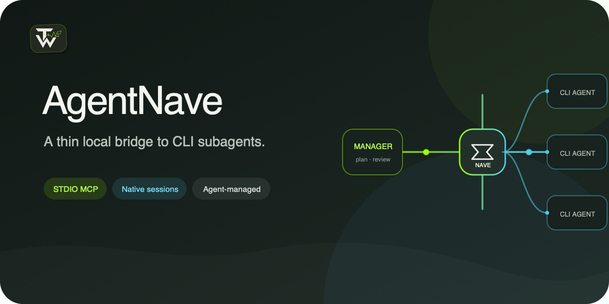

# AgentNave

<p align="center">
  
</p>

**A thin local bridge from Agent Managers to CLI subagents.**

AgentNave lets an Agent Manager launch Antigravity CLI, Claude Code, CodeBuddy Code, Codex CLI,
Grok CLI, or Pi Coding Agent as subagents, one at a time or as a group answering in parallel or
serial rounds. Each provider keeps its native authentication,
configuration, permissions, and session model; AgentNave supplies the adapter and process
supervision around it.

The boundary is intentional. AgentNave does not plan tasks, assign roles, build DAGs, choose
parallelism, review results, synthesize answers, retry work, or manage worktrees. Those decisions
belong to the calling Agent Manager, where the full task context already exists.

AgentNave has no human-facing CLI. The `agentnave-mcp` command is only the STDIO entry point used by
a compatible MCP host.

In the tray app, **Settings → Avatars** lets you upload a custom image or restore the official
model icon. Overrides can target a model family, a manager host, or a specific CLI/model pair.
They stay in `avatars.json` in the local data directory and are shared by chat, tray, and browser views.

## What AgentNave owns

| AgentNave | Calling Agent Manager |
| --- | --- |
| Provider command adapters | Planning and task decomposition |
| In-memory invocation lifecycle | Provider and model selection |
| POSIX process groups / Windows Job Objects | Parallelism, review, and synthesis |
| Normalized terminal results | Retries, permissions, and worktrees |
| In-memory parallel and serial group rounds | Who answers, in what order, and acceptance |

## Requirements

- Windows, macOS, or Linux
- `uv` and Git (for installation from a release tag)
- At least one authenticated provider CLI

`uv` installs AgentNave in an isolated Python 3.12 environment. A separately managed system
Python is not required.

AgentNave uses dedicated POSIX process-group supervisors on macOS/Linux and kill-on-close Windows
Job Objects on Windows. Windows providers are created suspended, assigned to the Job Object, and
only then resumed so descendants cannot start outside the owned process tree.

## Install

Install the MCP runtime and companion [agentnave-manager Skill](skills/agentnave-manager/SKILL.md)
as a pair. The runtime exposes the tools; the Skill teaches the calling Agent how to use other
CLIs. Planning, scheduling, review, retry decisions, and synthesis remain with the calling Agent.

Follow the [installation guide](docs/installation.md) to:

1. Check the existing runtime's source, version and launcher; reuse it when suitable, or install
   the missing runtime with `uv tool`.
2. Inspect the target host's effective MCP registration; reuse matching settings and add only
   a missing entry, with the host's provider exclusions.
3. Reuse the matching Skill or install its complete directory, including `references/`, from
   the same release. Existing shared sources need only a discovery entry for the new host.
4. Verify both MCP tools and Skill discovery; restart connections or sessions after changes.

Hosts under the same OS user and `uv` tool directories share installation files, but each MCP
connection runs its own STDIO service process. Adding a host does not require reinstalling the
runtime or authorize upgrading it for other hosts. The guide covers differences and shared updates.

The guide covers host registration, provider paths, Skill installation, paired upgrades, rollback,
and removal. Provider CLIs must be installed and authenticated separately. `uv` manages only the
runtime; it does not install the Skill or modify provider permissions and configuration.

**The paired release is `v0.22.0`.** Install the runtime and complete Skill directory from that
tag. `uv tool` installs only the runtime; Skill discovery is a separate step. Hosts without
Skill support can still use MCP alone. The older `v0.5.0` tag contains only the runtime.
`v0.10.0` is the first paired release with native Windows support.

The `agentnave` package saves nothing: it creates no data directory, listens on no port and writes
nothing to the caller's working directory. Provider authentication, configuration and native
sessions remain owned by their respective CLIs.

## Group rounds

`open_group` registers 2–6 seats in memory. A seat is an ordinary subagent: native tools and
permissions, the group or its own `cwd`, and explicit provider options. `run_round` asks an ordered
list of seats to answer one shared task once:

- `parallel`: all start together and cannot see each other's answers in this round;
- `serial`: one after another, each seeing the earlier answers.

Seats share only final answers. Each round's task, answers and absences (failed, blocked or
cancelled seats) become entries; every seat receives the entries it has not yet seen and resumes
its own native session, and an optional private instruction goes to one seat only. Independent
answers, several independent rounds, turn-taking discussion or "answer first, then discuss" are
combinations of lists and orders, not modes. `wait_round` and `cancel_round` mirror `wait_agent`
and `cancel_agent`; `cancel_agent` on one seat records it absent and lets a serial round continue.
Groups last only for the server process. Seats sharing one repository can interfere; give writing
seats their own worktree through the seat `cwd`.

Later rounds receive earlier committed answers, even when every round is parallel. Switching
from discussion to parallel does not restore blind answers; use new groups and native sessions
when independence from earlier discussion matters. Serial order intentionally gives later seats
more information; a final parallel round lets everyone respond to all earlier objections.

`wait_round(include_output=false)` omits answer bodies and running reply tails while keeping
statuses, activity, errors and session IDs. The default remains `true`; answers can be read again
with `true`, including Studio answers awaiting review. Finished round elapsed time is fixed.
Round `finished` means orchestration ended, not that every seat succeeded. Unexpected driver or
state-write failures return round status `failed` and an error; active seats are settled before
another round starts.

## AgentNave Studio

For multi-CLI shows that a person watches, register the `agentnave-studio-mcp` launcher instead;
the same `agentnave` package installs it. It includes every core tool and adds saved history
under `~/.agentnave/` (or `AGENTNAVE_DATA_DIR`), optional review of answers before other seats see
them, host messages, isolated seats with restricted tools, and a local read-only dashboard that
starts automatically after a saved task or show is created or continued. See the [studio guide](docs/studio.md).

## The MCP surface

This section describes `v0.15.0`, which retains native Windows process-tree supervision and
the fixed five-minute wait contract introduced in `v0.9.0`.
Start, wait and cancel use flat lifecycle responses; callers upgrading from v0.6.0 must also
update their response handling and paired Skill.
Restart the MCP connection after updating the runtime to refresh its schemas.

AgentNave exposes eleven tools: six for single tasks, four for group rounds and one for configured members. The initial tool metadata contains a compact provider directory;
provider-specific options are returned only when requested. App member defaults are applied by mode; CLI references provide supplementary guidance.

### `describe_provider`

Call with the selected `provider` before its first use in the current context. Returns that
provider's permitted status, supported options, and detected `host` / `host_source`.
Reuse the result for later calls with the same provider. This tool neither launches a CLI nor
checks installation or authentication; it does not consume provider quota or change the tool list.

For example: `describe_provider({"provider": "grok"})` → `start_agent(...)` → `wait_agent(...)`.

### `list_members`

每次现读数据根（`AGENTNAVE_DATA_DIR`，默认 `~/.agentnave`）下的 `members.json`，返回 `configured`、`host`、`host_source` 与 task／discussion 两种模式的生效组员配置。每个组员以 `(provider, model)` 为身份，包含默认标志、努力档位、参数、说明及 Adapter 校验的 `valid`／`error`。task 的 `permitted` 反映宿主排除集合，discussion 恒为 true；组员名单本身表达模式限制。工具不创建文件、不启动 CLI、不检查安装、认证或模型是否可用。

模式键缺失表示不限制，空模式对象表示禁止全部 CLI，CLI 的空模型列表表示不限模型；除已配置模型外，还用 `model="*"` 的空配置条目说明不限模型。文件缺失时 `configured=false`，两种模式均不受限且名单为空；文件损坏返回 Tool error，需在 App 中修复。App 保存组员配置并迁移旧档案，服务不再提供 `list_profiles` 或读取 `profiles.json`。

### `start_agent`

Starts one provider invocation and immediately returns an in-memory `invocation_id`. It requires
`provider`, `prompt`, and an absolute existing `cwd`; `session_id` and explicit
`provider_options` are optional.

启动回执包含 `provider`、`model`、`effort` 与 `defaults_applied`，不重复 prompt。task 模式先检查允许的 CLI 与宿主排除项，再补齐 App 中配置的 model、effort 和其他 options；调用方显式参数优先，超出模式允许的模型或努力档位时拒绝；非空模型名单既无默认又未传 model 时也拒绝，不能退回原生模型。续接同样现读并套用默认值。参数仍经 Adapter 原有校验；未传且无默认值时显示 `继承原生设置`。`defaults_applied` 列出实际补齐的键，无则空列表；这些请求值不证明 CLI 实际生效的设置。`open_group` 每席使用 discussion 配置，并返回 model、effort（未配置时为 null）与 `defaults_applied`。

支持的 Provider 为 `antigravity`、`claude`、`codebuddy`、`codex`、`grok`、`pi`。宿主识别优先 `AGENTNAVE_HOST`，否则在 macOS／Linux 沿祖先进程最多 32 层匹配 CLI 或应用包；Windows 只读环境变量。未知宿主不做自我排除，未知环境变量值使启动失败。宿主 Provider（WorkBuddy 对应 codebuddy）与已有 `AGENTNAVE_EXCLUDED_PROVIDERS` 取并集，只限制 task，不限制讨论席位；discussion 自身的组员名单仍生效。Codex 在非 Git 目录可显式传 `{"skip_git_repo_check": true}`，或在 App 组员 options 中保存该默认值。

Pi Coding Agent uses `pi --print --mode json`, with prompts on stdin and native session IDs
for continuation. Install it with `npm install -g --ignore-scripts @earendil-works/pi-coding-agent`,
then run `pi` and `/login`. Without App defaults, omitted model and effort options use Pi's native settings; explicit
`effort` maps to `--thinking`. Pi runs with the permissions of its launching process.

### Choosing a model and reasoning effort

For Codex, explicitly pass `{"dangerously_bypass_approvals_and_sandbox": true}` in
`provider_options` to enable native YOLO (`--dangerously-bypass-approvals-and-sandbox`).
This skips approval prompts and disables sandboxing for that invocation, including when
resuming a session. Only enable it when the user authorizes both effects. Passing `false`
or omitting it when no App default exists adds no flag and inherits native settings; it does not force a sandbox
or approvals back on. The CLI's saved configuration is unchanged.

For Antigravity, explicitly pass `{"dangerously_skip_permissions": true}` in
`provider_options` to enable native YOLO (`--dangerously-skip-permissions`) for one invocation.
This auto-approves all native tool permission requests for that invocation without changing
the CLI's saved configuration. With no App default, omit the option to inherit native settings, or pass `false`
to explicitly disable the flag. Only enable it when the user authorizes permission bypass;
`mode` and `sandbox` are separate options and do not imply YOLO.

On macOS, AgentNave prefers the executable CLI bundled with the ChatGPT desktop app,
then the Codex desktop app, checking `/Applications` before `~/Applications` for each.
This follows desktop app updates instead of selecting an independently installed CLI by PATH.
If no executable bundle is found, or on other platforms, AgentNave uses `codex` from PATH,
then from the common install directories listed in the installation guide.
AgentNave does not install or upgrade Codex, compare version numbers, or change its model settings.

用户可在单次任务中点名 CLI、模型与 effort，由主控显式传入 `provider_options`，覆盖 App 默认值但仍须处于该模式允许范围。长期默认值在 App 中维护；要继承 CLI 原生设置，应清除对应 App 默认字段并在调用时省略，单纯省略参数仍会套用已配置的默认值。新增模型可直接使用其精确 ID；若模式限制模型，须先在 App 中启用。模型不可用时报告原错误，不静默替换。

### `wait_agent`

Each request has a fixed five-minute (300-second) wait window; `wait_agent` accepts only
`invocation_id`. Completion or a recognized execution blocker returns early. Expiry leaves the
invocation running; call again with the same ID to continue. If a host yields a background
call handle, resume that call using the host's wait mechanism before issuing another request.

Start, wait and cancel use one flat response: `invocation_id`, `status`, `reason`, `elapsed_ms`,
plus applicable `activity`, `error`, `output`, `output_age_ms` and `session_id` fields. Reasons are
`started`, `wait_elapsed`, `execution_blocked` and `finished`. Running replies include the latest
public reply tail (at most 1,000 Unicode characters), retained across tool events, and its age.
No new public reply means the same tail can recur; unavailable fields are omitted. There is no
cursor, pagination or separate output-reading tool. Final replies are not subject to the tail limit.
Provider usage/cost, native event names, tool call IDs, tool payloads and thinking are not returned.
Public replies may still contain task data; this is not a redaction service.

`execution_blocked` leaves `status=running`: the Manager decides whether to keep waiting or cancel.
Each recognized blocker category wakes once per invocation, avoiding repeated immediate returns
from the same retry loop. Ordinary tool failures, transient retries and silence do not imply a
blocker; unrecognized errors may only become visible in output or the final result. There is no
unsolicited completion/error push without a pending wait request.

Wait expiry never terminates the invocation. AgentNave has no total runtime deadline and
`start_agent` has no runtime-limit parameter. Keep waiting for the result or use `cancel_agent`
to stop work explicitly. Provider-native limits still apply.

### `wait_any`

Waits on several distinct, known `invocation_ids` with the same fixed five-minute window; an
empty, repeated, unknown or expired ID rejects the whole call before waiting. It returns
`{"reason": "ready" | "wait_elapsed", "updates": [...]}`, where each update has the
`wait_agent` shape. `ready` lists every invocation that has finished or has an unread blocker at
that moment; the others keep running and are omitted. Only blockers placed in the reply are
consumed. Finished invocations stay ready on every call, so drop them from the next list.
`wait_elapsed` returns a running snapshot of each invocation and consumes nothing.

### `cancel_agent`

Stops an invocation and returns its terminal result. Use it only when the Manager intends to end
active provider work; `wait_agent` observes without cancelling.

### `list_invocations`

Read-only list of this server's active invocations and finished ones within the seven-day
retention, oldest first: `invocation_id`, `provider`, `cwd`, `status`, `elapsed_ms` (fixed once
finished) and `events_seen` (whether any structured provider event arrived), plus `phase` while
active and a non-empty native `session_id` once finished. Prompts, replies and tool data are not
returned; read results with `wait_agent` or `wait_any`.

All tools publish input and output JSON Schemas. Agent-correctable request errors are MCP Tool
errors with retry guidance; provider launch and execution outcomes remain structured Invocation
Results.

### Output size

Each invocation retains at most 1 MiB of stdout (including required protocol data) and
64 KiB of stderr. Exceeding either limit fails the invocation with `output_limit_exceeded`
and stops its process tree. Filtered providers retain the existing 8 MiB per-event parsing
bound so large discarded tool/image events do not consume the reply budget. These are
byte limits, not token or reply-length budgets.
The Manager should request concise replies and account for all seats together. For large
reports or attachments, a CLI with file tools can write an explicitly requested file and
return a summary plus its absolute path; AgentNave does not transfer attachments or
automatically save oversized replies. Isolated shows cannot rely on file tools.

## Lifecycle and security

Invocation handles live only in the current MCP server process. When the server stops, AgentNave
makes a best-effort attempt to terminate processes that remain in the provider process tree. A
restart cannot recover old handles, but a retained provider `session_id` can be supplied to a new
`start_agent` call.

Finished invocation records are automatically removed from memory seven days after completion,
including unread results. Reads do not extend retention, and active invocations are never expired.
Keep the final answer and native `session_id` before expiry; waiting or cancelling an expired handle
returns a Tool error. Cleanup does not delete provider-native sessions, group answers, or Studio's
saved history.

Running responses help inspect health and direction using a bounded public reply and native
activity. They do not show every active operation or guarantee progress. Raw streams remain
bounded in process memory; no output log/database is added. A 1,000-character reply tail is kept
per invocation for waiting responses. Final results remain available for this server process.

Use the companion Skill's working-directory and target-path guidance to select `cwd` and describe
the task in the prompt. Project rules load through the CLI's native mechanism.
Antigravity can choose a different terminal `Cwd`:
state the absolute project directory in the handoff, require that terminal directory explicitly,
and verify it with `pwd` before project operations. This is a behavioral instruction, not enforced
directory isolation. `provider_options.project` selects a native project ID or name; it is not a
working-directory override. The companion Skill guides task handoffs and keeps
intermediate files in OS temporary storage without imposing Markdown or a result-file format.
AgentNave itself uses stdin/in-memory output except for Grok's temporary prompt file, which is
removed after use. Provider-owned history and caches remain under provider control.

AgentNave is not a sandbox. On POSIX, a same-user provider with command permission can deliberately
daemonize, kill its supervisor, or otherwise escape ordinary process-group cleanup. Windows Job
Objects provide tree ownership but do not isolate the provider from the user account or the rest of
the machine. Provider-native permissions remain the security boundary; use OS-level isolation when
adversarial containment is required.

## Verify

These checks are for a development checkout, not the `uv tool` installation above. See
[CONTRIBUTING.md](CONTRIBUTING.md) for the complete contributor workflow.

```bash
uv sync --locked --all-groups
uv run ruff format --check .
uv run ruff check .
uv run pyright
uv run pytest
```

## Contributing and security

Contributions are welcome through GitHub Issues and pull requests. See
[CONTRIBUTING.md](CONTRIBUTING.md) for the development workflow and validation requirements.

Do not report security vulnerabilities in a public Issue. Follow [SECURITY.md](SECURITY.md) to use
the repository's private vulnerability reporting channel.

## License

AgentNave is licensed under the [MIT License](LICENSE).
