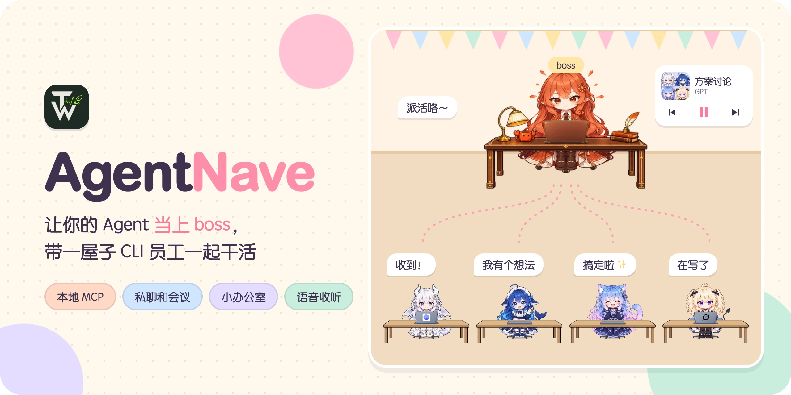
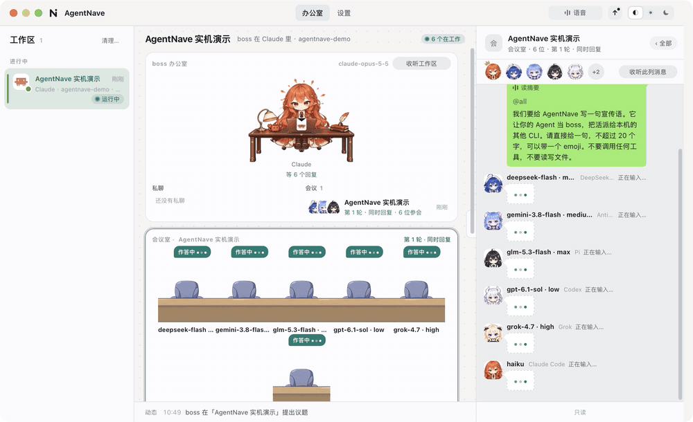
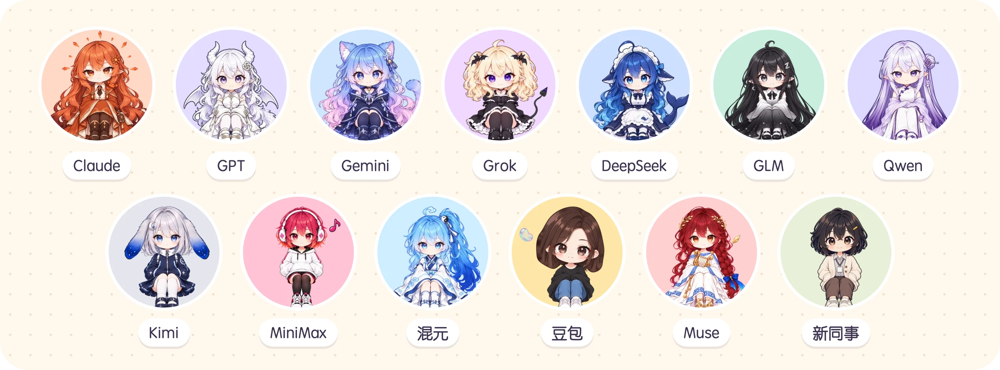

<p align="center">
  
</p>

<p align="center">
  <b>简体中文</b> · <a href="README.en.md">English</a>
</p>

<p align="center">
  <a href="https://github.com/TimWongUp/agentnave/releases/latest"></a>
  <a href="LICENSE"></a>
  
  
  
</p>

**AgentNave 是一个本地 MCP 服务。** 让你正在用的 Agent（Claude Code、Codex……）当 boss，把活派给本机装好的其他 CLI。配套的托盘 App 是一间小办公室：谁在干活、谁在开会、大家说了什么，都看得见，也听得到。

## 🎬 实机演示

<p align="center"></p>

## ✨ 几大特点

### 🧑‍💼 一个 boss，一屋子 CLI

13 种宿主能当 boss，9 种 CLI 能当员工，派活用的是同一套工具。每个 CLI 继续用自己的登录和配置，聊过的会话之后还能接着聊。

### 👯 私聊和会议

可以单独派一位员工，结果只回给 boss；也可以请 2–7 位员工开会：默认两轮并联，第一轮各自给方案，第二轮看过大家的回答再补充，最后由 boss 总结；想接力收尾就加一轮串联。开了审核，每条回答由 boss 决定公开还是留作私聊，不公开的回答其他席位看不到。

### 🏢 看得见的小办公室

工位、会议室和完整对话一目了然，菜单栏随时能看谁在干活。小人按模型家族出场，也可以上传自己的一套。宿主退出时，它派出的任务随之取消，会议席位记为本轮缺席；服务进程被强杀、来不及收尾时，下次打开显示为已中断。失联的任务都不会一直挂着运行中。

### 🎧 听得到的办公室

点一下「收听」，App 就把会议、私聊或整个工作区读给你听，默认听 1 小时，到时自动停。每场会议或私聊是一张专辑，点说话人能跳到正在读的消息。语音用你自己的 ElevenLabs 或 MiniMax 密钥，发言文本会发给所选的云端引擎。

### 🙋 弹框由 boss 代答

在 macOS 和 Linux 上，Claude 默认以交互模式运行，省订阅额度。运行中的权限框、提问框和计划确认交给 boss 回答，不用你守着。Devin 自动审批判断不了的操作也交给 boss。CLI 权限档位默认完全放开，也可以在 App 里改成自动审批。

### 🧭 工位和评审

在 App 里给通用探索、通用执行的简单和困难两档选好模型，按需开启界面制作、写作、网页调研等专项，boss 按任务类型和难度派活。可选的生图工位只需选 CLI 和对话模型，由它调用自身的生图服务。还可以加一道[合并前评审](skills/agentnave-review/SKILL.md)：按风险大小决定派谁来看，评审的员工只读不改，结论留作记录。

### 🤝 换个聊天接着干

对 boss 说「转交这个会话」，到新聊天说「接手」。额度用完写不了交接文档时，也能让新 boss 接手那个宿主的会话。

### 🧹 App 替你管杂事

接入宿主时顺便装好 Skill，员工要确认后才能派发。CLI 有新版本时一键更新，没装的给出官方安装命令。App 和本机服务在 App 里更新，旧工作区一键清理，历史按你设的天数自动清理。

## 👀 谁当 boss，谁当员工

| 角色                              | 支持                                                                                                                                |
| --------------------------------- | ----------------------------------------------------------------------------------------------------------------------------------- |
| **boss**（接入 AgentNave、负责派活） | Claude 桌面端、Claude Code、Codex CLI、CodeBuddy Code、WorkBuddy 桌面端、Grok CLI、Antigravity、Pi、DeepSeek Harness、ZCode、Devin CLI／桌面端、Hermes、Grok Bot（仅 Linux） |
| **员工**（被派活的 CLI）          | Claude Code、Codex CLI、CodeBuddy Code、Grok CLI、Antigravity CLI、Pi Coding Agent、DeepSeek Harness、ZCode、Devin CLI                         |

宿主不会把单个任务派给自己的 CLI，但会议里可以有它的席位。

Codex 员工同时检测到桌面端内置 CLI 和独立 CLI 时，可在「员工」页选择运行来源。默认「自动」优先使用内置版；固定选择的安装不可用时，派发会报错，不会改用另一份。

Grok Bot 只能在 Linux 上接入，不支持 macOS 和 Windows App，也看不到它的模型和会话记录，详见[无头 Linux 宿主指引](docs/linux-headless.md)。

## 🎀 员工图鉴

<p align="center">
  
</p>

小人按**模型家族**分配，不看用的是哪个 CLI：用 Codex CLI 跑 GPT，出场的就是 GPT 那位小龙娘。没有专属形象的模型由「新同事」代班。
在 App 设置的「外观」页可以切换 CSS 小人与视频小人包，也可以按模型家族上传一套自定义 CSS 小人，见[自制与更换办公室 CSS 小人教程](docs/custom-characters.md)。

## 🚀 快速开始

先准备好 [`uv`](https://docs.astral.sh/uv/)、Git，以及至少一个已经登录的 CLI。AgentNave 不帮你安装或登录 CLI。

### 方式一：托盘 App（macOS、Windows，推荐）

1. 到 [Releases](https://github.com/TimWongUp/agentnave/releases/latest) 下载安装包：macOS 用 `AgentNave_<版本>_universal.dmg`，拖进「应用程序」；Windows 用 `AgentNave_<版本>_x64-setup.exe`。
2. 打开 App，在设置的「boss」页接入一个宿主，按需在「员工」页确认其他 CLI。本机服务和配套 Skill 由 App 自动安装。
3. 回到宿主里说一句试试：

   ```text
   用 agentnave 让两位员工各自回答一遍：这个仓库是做什么的？
   ```

### 方式二：手动安装（Linux，或不装 App）

当前配套版本是 **`v1.7.0`**，运行时和 Skill 都要从这个 tag 安装：

```bash
uv tool install --python 3.12 "git+https://github.com/TimWongUp/agentnave.git@v1.7.0"
```

然后按[安装指南](docs/installation.md)注册 MCP、安装 [agentnave-manager](skills/agentnave-manager/SKILL.md) 和 [agentnave-handover](skills/agentnave-handover/SKILL.md) Skill，再做验证。
安装指南本来就是写给 Agent 看的，可以直接交给你的 Agent，让它照着检查和安装。
**无头 Linux（没有 App）**：比如 Grok Bot 这类跑在 Linux 上、只能以 MCP 连接器接入的 bot，按 [Linux 装完后的设置指引](docs/linux-after-install.md) 一步步带用户完成设置，配置文件的细节见 [无头 Linux 宿主接入指引](docs/linux-headless.md)。

任务和会议的历史保存在 `~/.agentnave/`（也可以用 `AGENTNAVE_DATA_DIR` 指定别的目录）。各 CLI 的登录、配置和原生会话仍归 CLI 自己管。

## 🧭 分工：AgentNave 管什么

AgentNave 只负责把活派出去、管好进程、把结果原样带回来。怎么拆任务、找谁、要不要复核，都由 boss 来定，因为完整的上下文在 boss 手里。

| AgentNave                | boss                           |
| ------------------------ | ------------------------------ |
| 启动和停止各家 CLI       | 规划和拆分任务                 |
| 盯着任务跑完，不留残余进程 | 选谁来做、用什么模型           |
| 把结果原样带回来         | 同时派几位、要不要复核         |
| 保存任务和会议记录       | 失败了要不要重试               |
| 主持会议的轮次           | 谁来答、按什么顺序、答得行不行 |

AgentNave 默认让派出去的 CLI 完全放开权限，也可以在 App 里选择自动审批。Claude 以交互模式运行时和 Devin 运行时，仍要确认的弹框由 boss 代答。
AgentNave 没有给人用的命令行，你只需要跟 boss 说话。

<details>
<summary>🔒 任务的去留与安全</summary>

宿主关闭时，AgentNave 会停掉还在跑的员工，已保存的记录还在，保存的会议和聊过的会话之后都能继续。

**AgentNave 不是沙箱。** 它只负责管好进程，员工能做什么取决于各 CLI 自己的权限设置。需要严格隔离时，请用操作系统级别的隔离。

</details>

<details>
<summary>🛠️ 开发与验证</summary>

下面的检查用于开发用的 checkout，不适用于上面的 `uv tool` 安装。完整流程见 [CONTRIBUTING.md](CONTRIBUTING.md)。

```bash
uv sync --locked --all-groups
uv run ruff format --check .
uv run ruff check .
uv run pyright
uv run pytest
```

</details>

## 🤝 参与贡献

欢迎通过 GitHub Issue 和 Pull Request 参与，开发流程和验证要求见 [CONTRIBUTING.md](CONTRIBUTING.md)。
安全漏洞请不要发公开 Issue，按 [SECURITY.md](SECURITY.md) 走仓库的私密报告渠道。

## 🙏 致谢

托盘查看会话的思路，以及读取 Claude、Codex 会话记录判断 boss 所在应用的做法，参考了 [magpie](https://github.com/yetone/magpie)。CLI 图标来自 [LobeHub Icons](https://github.com/lobehub/lobe-icons)（MIT）。

## 📄 许可证

AgentNave 以 [MIT 许可证](LICENSE)发布。
